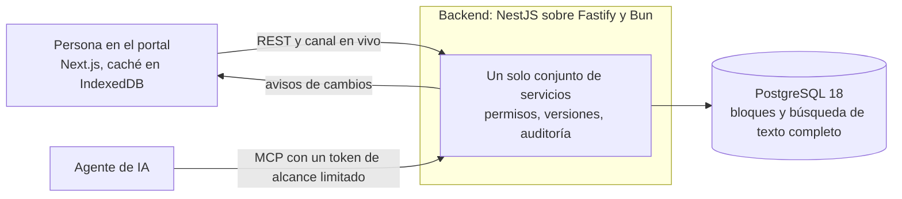

# NEUMA

[English](./README.md) · **Español**

[](https://github.com/El-Vitas/neuma/actions/workflows/ci.yml)
[](./LICENSE)


**Neural Enterprise Unified Memory & Agents.** El cerebro de la empresa: cada bloque es una neurona, cada enlace una sinapsis, y los agentes piensan con él.

https://github.com/user-attachments/assets/04d71b3c-a57b-44cc-9eb9-a5b708c616dc

NEUMA es la memoria interna de una organización. Todo es un bloque, incluso la página: espacios con páginas que se editan en vivo entre varias personas, colecciones con vistas, búsqueda de texto completo y retroenlaces. Los agentes de IA trabajan en ella como una persona más, a través de un servidor MCP con los mismos permisos que la aplicación.

**Primero los agentes.** NEUMA se diseña antes para agentes de IA que para personas. No basta con que un agente pueda hacer lo mismo que una persona: NEUMA inventa herramientas, algoritmos y estructuras pensadas para cómo trabaja un agente, con contexto preciso y citable, cambios desde su última visita y acciones que se pueden previsualizar. El portal existe y se usa, pero el producto es una memoria con la que los agentes piensan (ver «Product Principle: Agent First» en `AGENTS.md`).

Para los agentes, NEUMA es una arquitectura de memoria unificada (*Neural Enterprise Unified Memory Architecture*): cada conocimiento tiene un id estable que se puede citar, se enlaza con otros y se encuentra con una búsqueda, y cada agente solo ve lo que puede leer la persona dueña de su token.

El nombre también viene de los neumas, la primera notación musical: signos pequeños que, juntos, forman el canto. Aquí cada bloque es un neuma.

Cada despliegue atiende a una sola organización, y solo entran las personas a las que un administrador les crea una cuenta.

## Qué hace

- **Páginas y espacios.** Jerarquía de páginas con historial de versiones, papelera, favoritas, íconos y exportación. Los espacios pueden ser internos, restringidos o privados.
- **Editor en vivo.** Editor ProseMirror sobre bloques, con un canal en vivo y Yjs para el texto de cada bloque, con diagramas Mermaid, fórmulas, tablas, adjuntos y menciones entre páginas.
- **Colecciones.** Una página puede llevar un esquema de propiedades, y sus páginas hijas se ven como tabla, tablero, lista, galería o calendario.
- **Búsqueda y retroenlaces.** Búsqueda de texto completo en PostgreSQL por página y por bloque, y la sección «Vinculado desde». Las dos salen de los bloques y están al día apenas se confirma el cambio.
- **Agentes.** Servidor MCP en `/api/v1/mcp` con tokens de acceso de alcance limitado. Cada acción de un agente queda auditada.

## Cómo funciona



La persona y el agente pasan por los mismos servicios, así que un agente nunca puede hacer lo que no podría la persona dueña de su token.

## Decisiones de ingeniería

Cada decisión queda escrita como ADR en `docs/architecture/adr/`, con las alternativas que se descartaron. Estas son las que dan forma al producto:

- **Todo es un bloque, incluso la página** ([ADR 021](docs/architecture/adr/021-everything-is-a-block.md)). Permisos, movimientos, enlaces, versiones y papelera se resuelven una sola vez para todos los bloques, en vez de una vez para las páginas y otra para su contenido. La búsqueda y los retroenlaces se leen de los bloques, así que están al día apenas se confirma un cambio.
- **Las vistas son consultas a la base** ([ADR 025](docs/architecture/adr/025-views-as-reducer-queries.md)). Una tabla, un tablero o un calendario es una consulta que PostgreSQL responde con un cursor por clave, así que una colección grande se pagina en vez de cortarse.
- **Avisos de cambios en vivo por colección** ([ADR 026](docs/architecture/adr/026-collection-change-notices.md)). Cuando alguien mueve una tarjeta, todos los que miran esa colección lo ven sin recargar, después de que el servidor comprueba que pueden leerla.
- **El árbol de páginas se carga a pedido** ([ADR 030](docs/architecture/adr/030-page-tree-on-demand.md)). En un espacio de 12.000 páginas, abrir una página descargaba un documento de 40 MB con el espacio entero. Ahora trae solo la rama que se ve.
- **Las sesiones se pueden revocar** ([ADR 018](docs/architecture/adr/018-revoke-sessions-with-a-token-version.md)). Cerrar sesión o cambiar la contraseña termina todas las sesiones abiertas, con un número de versión en la cuenta en vez de una lista de tokens.
- **Cada ejecución de las pruebas de integración tiene su propia base** ([ADR 011](docs/architecture/adr/011-isolate-integration-tests-by-database.md)), así que las pruebas corren contra un PostgreSQL real sin pisarse.

Las convenciones se hacen cumplir, no solo se escriben. Reglas propias de ESLint, plugins de GritQL y dependency-cruiser revisan los límites entre módulos y la organización de archivos. El CI corre formato, lint, tipos, las pruebas y un escaneo de gitleaks sobre todo el historial, con las acciones fijadas por SHA y las imágenes por digest.

## Estructura

| Workspace | Qué es | Puerto |
|---|---|---|
| `apps/backend` | API NestJS 11 sobre Fastify y Bun, el servidor MCP y el canal en vivo del editor | 3000 |
| `apps/portal` | Next.js 16 (App Router), React 19 y Tailwind 4 | 3010 |
| `packages/db` | Contrato de Prisma ORM 8, migraciones y seed para PostgreSQL 18 | — |
| `packages/shared` | Tipos, esquemas y lógica compartida entre backend y portal | — |
| `packages/design` | Tokens de diseño en modo claro y oscuro | — |
| `packages/eslint-rules` | Reglas de ESLint que hacen cumplir la arquitectura del repo | — |
| `packages/rules-cli` | CLI del registro de reglas de negocio en `docs/business-rules/` | — |

## Desarrollo local

Requiere Bun 1.4 y Docker o Podman para PostgreSQL.

```bash
bun install
cp .env.example .env
docker compose up -d postgres
cd packages/db && bun run db:migrate:deploy && bun run db:seed && cd ../..
bun run dev
```

`bun run dev` levanta el backend y el portal; no hace falta ningún otro proceso.

El seed crea tres usuarios, `admin@example.com`, `worker@example.com` y `client@example.com`, con la contraseña definida en `packages/db/prisma/seed/users.seed.ts`.

## Comandos

```bash
bun run dev          # backend y portal en modo watch
bun run check        # formato, lint y tipos de todo el monorepo
bun run check:ramless  # lo mismo, de a una tarea, para máquinas con poca memoria
bun run test:ramless  # pruebas de todos los workspaces
bun run rules:query  # consultar las reglas de negocio
```

## Con Docker

`docker-compose.yml` levanta PostgreSQL, las migraciones (una vez), el backend y el portal.

No hay registro abierto. En una instalación nueva, el primer administrador se crea una sola vez desde el servidor, y después los administradores crean las cuentas desde «Usuarios»:

```bash
read -rs CLAVE && printf '%s' "$CLAVE" | docker compose exec -T backend \
  bun run admin:create --email tu@example.com --name "Tu Nombre"; unset CLAVE
```

## Documentación

- `AGENTS.md`, en la raíz y en cada app: las convenciones de ingeniería, para personas y agentes.
- `docs/architecture/adr/`: las decisiones de arquitectura y por qué se tomaron.
- `docs/business-rules/`: las reglas de negocio, versionadas y consultables con `bun run rules:query`.
- `docs/scope/`: el alcance actual y lo que queda fuera.
