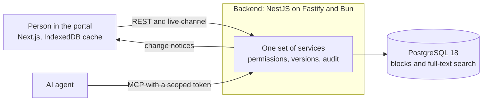

# NEUMA

**English** · [Español](./README.es.md)

[](https://github.com/El-Vitas/neuma/actions/workflows/ci.yml)
[](./LICENSE)


**Neural Enterprise Unified Memory & Agents.** The company brain: every block is a neuron, every link a synapse, and agents think with it.

https://github.com/user-attachments/assets/86762689-74af-40d6-b593-8a1d1f256126

NEUMA is an organization's internal memory. Everything is a block, even the page: spaces with pages that several people edit live, collections with views, full-text search and backlinks. AI agents work in it like one more person, through an MCP server with the same permissions as the application.

**Agents first.** NEUMA is designed for AI agents before people. It is not enough for an agent to be able to do what a person does: NEUMA invents tools, algorithms and structures built around how an agent works, with precise, citable context, changes since its last visit and actions that can be previewed. The portal exists and is used, but the product is a memory that agents think with (see "Product Principle: Agent First" in `AGENTS.md`).

For agents, NEUMA is a unified memory architecture (*Neural Enterprise Unified Memory Architecture*): every piece of knowledge has a stable id that can be cited, is linked to others and is found with a search, and each agent only sees what the person who owns its token can read.

The name also comes from neumes, the first musical notation: small signs that, together, form the chant. Here every block is a neume.

Each deployment serves a single organization, and only people for whom an administrator creates an account get in.

## What it does

- **Pages and spaces.** A hierarchy of pages with version history, trash, favorites, icons and export. Spaces can be internal, restricted or private.
- **Live editor.** A ProseMirror editor over blocks, with a live channel and Yjs for the text of each block, with Mermaid diagrams, formulas, tables, attachments and mentions between pages.
- **Collections.** A page can carry a property schema, and its child pages are seen as a table, board, list, gallery or calendar.
- **Search and backlinks.** PostgreSQL full-text search by page and by block, and the "Linked from" section. Both come from the blocks and are up to date as soon as the change is confirmed.
- **Agents.** An MCP server at `/api/v1/mcp` with limited-scope access tokens. Every action of an agent is audited.

## How it works



The person and the agent go through the same services, so an agent can never do what the owner of its token could not.

## Engineering decisions

Every decision is written down as an ADR in `docs/architecture/adr/`, with the alternatives that were rejected. These are the ones that shape the product:

- **Everything is a block, even the page** ([ADR 021](docs/architecture/adr/021-everything-is-a-block.md)). Permissions, moves, links, versions and trash are solved once for every block, instead of once for pages and again for their content. Search and backlinks are read from the blocks, so they are current as soon as a change is confirmed.
- **Views are database queries** ([ADR 025](docs/architecture/adr/025-views-as-reducer-queries.md)). A table, board or calendar is a query that PostgreSQL answers with a key cursor, so a large collection is paged instead of cut off.
- **Live change notices per collection** ([ADR 026](docs/architecture/adr/026-collection-change-notices.md)). When someone moves a card, everyone looking at that collection sees it without reloading, once the server has checked that they can read it.
- **The page tree loads on demand** ([ADR 030](docs/architecture/adr/030-page-tree-on-demand.md)). In a space with 12,000 pages, opening a page used to download a 40 MB document with the whole space. Now it fetches only the branch on screen.
- **Sessions can be revoked** ([ADR 018](docs/architecture/adr/018-revoke-sessions-with-a-token-version.md)). Signing out or changing the password ends every open session, through a version number on the account instead of a list of tokens.
- **Each integration test run gets its own database** ([ADR 011](docs/architecture/adr/011-isolate-integration-tests-by-database.md)), so the tests run against a real PostgreSQL without stepping on each other.

The conventions are enforced, not only written. Custom ESLint rules, GritQL plugins and dependency-cruiser check module boundaries and file layout. CI runs format, lint, types, the test suites and a gitleaks scan over the whole history, with actions pinned by SHA and images by digest.

## Structure

| Workspace | What it is | Port |
|---|---|---|
| `apps/backend` | NestJS 11 API on Fastify and Bun, the MCP server and the editor's live channel | 3000 |
| `apps/portal` | Next.js 16 (App Router), React 19 and Tailwind 4 | 3010 |
| `packages/db` | Prisma ORM 8 contract, migrations and seed for PostgreSQL 18 | — |
| `packages/shared` | Types, schemas and logic shared between backend and portal | — |
| `packages/design` | Design tokens in light and dark mode | — |
| `packages/eslint-rules` | ESLint rules that enforce the repo's architecture | — |
| `packages/rules-cli` | CLI for the business rules registry in `docs/business-rules/` | — |

## Local development

Requires Bun 1.4 and Docker or Podman for PostgreSQL.

```bash
bun install
cp .env.example .env
docker compose up -d postgres
cd packages/db && bun run db:migrate:deploy && bun run db:seed && cd ../..
bun run dev
```

`bun run dev` starts the backend and the portal; no other process is needed.

The seed creates three users, `admin@example.com`, `worker@example.com` and `client@example.com`, with the password defined in `packages/db/prisma/seed/users.seed.ts`.

## Commands

```bash
bun run dev          # backend and portal in watch mode
bun run check        # format, lint and types for the whole monorepo
bun run check:ramless  # the same, one task at a time, for low-memory machines
bun run test:ramless  # tests for all workspaces
bun run rules:query  # query the business rules
```

## With Docker

`docker-compose.yml` starts PostgreSQL, the migrations (once), the backend and the portal.

There is no open sign-up. On a fresh install, the first administrator is created once from the server, and afterwards administrators create accounts from "Users":

```bash
read -rs PASSWORD && printf '%s' "$PASSWORD" | docker compose exec -T backend \
  bun run admin:create --email you@example.com --name "Your Name"; unset PASSWORD
```

## Documentation

- `AGENTS.md`, at the root and in each app: the engineering conventions, for people and agents.
- `docs/architecture/adr/`: the architecture decisions and why they were made.
- `docs/business-rules/`: the business rules, versioned and queryable with `bun run rules:query`.
- `docs/scope/`: the current scope and what is left out.
