A diagram is **written**, not dragged or drawn with the mouse. You write a few lines
describing what you want to show and the page draws it for you.

What the page keeps is the text, never the image. That is why a diagram can be searched,
copied, compared and corrected years later, and why two people who write the same thing get
the same drawing.

Diagrams are written in **Mermaid**, the most widely used diagram language: the same one
GitHub and GitLab understand. What you write here works as it stands in any of them,
and the other way round. Each kind has its own syntax page, linked below, and all of them hang
off the [Mermaid documentation](https://mermaid.js.org/intro/syntax-reference.html).

## How to insert one

1. Type `/` on an empty line and choose **Diagram**.
2. Write the diagram inside the block. The first line says which kind it is: `flowchart`,
   `sequenceDiagram`, `gantt`, and so on.
3. You can also start from a code block and switch its language to **Diagram** in the block
   bar: whatever is already written is drawn as it stands.

The drawing is remade when you stop typing, not on every keystroke. While you write, the
previous drawing stays on screen, dimmed, until the new one can be drawn.

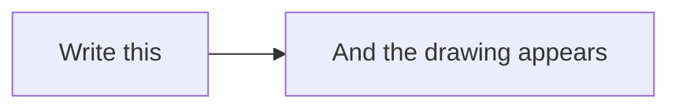

## Showing the code, the drawing, or both

The block bar is where you choose what is shown: **only the drawing**, **only the code**, or
**both**. What you choose is kept with the page, so whoever reads it later sees what you left.

- **Copy** copies the text of the diagram, ready to paste into another page.
- **Download** saves the drawing as an SVG file: a real drawing rather than a photograph, so
  it can be enlarged without going blurry.
- **Full screen** fills the screen with it.

## Reading a big one

A diagram is shown at the size it was drawn. If it is wider than the column it does not
shrink: its own box scrolls instead, so the writing inside stays readable.

- Drag the drawing with the mouse to move around it when it does not fit.
- Hold `Ctrl` (or `⌘`) and use the mouse wheel to bring it closer or push it away.
- When the page is printed, a diagram too wide for the sheet is fitted to it instead of being
  cut off, and the block buttons are left off the paper.

## Stamps and logos

Some kinds of diagram take pictures inside their boxes. They are named in two parts separated
by a colon: the book and the name of the picture.

Two books are available:

| Book | What it holds | When to use it |
|---|---|---|
| `logos` | The marks of known products, in their own colours | To name technologies and services |
| `mdi` | General purpose single-colour pictures that follow the page's theme | For everything else, and whenever it must read in both light and dark |

The pictures are served by this workspace itself: naming a stamp never makes your browser ask
anything of somebody else's server, and everything keeps working with no way out to the
internet. If you name one that does not exist, a square with a question mark appears in its
place and the rest of the diagram is drawn as usual.

```icons
logos:postgresql
logos:nestjs
logos:nextjs-icon
logos:docker-icon
logos:typescript-icon
logos:react
logos:google-cloud
logos:aws
mdi:account
mdi:folder
mdi:file-document
mdi:database
mdi:server
mdi:email
mdi:cog
mdi:alert-circle
```

Any name from these two collections works, not only the ones above. Look it up in
[Logos](https://icon-sets.iconify.design/logos/) or
[Material Design Icons](https://icon-sets.iconify.design/mdi/) and write the name exactly as
it appears there, with the book in front of it.

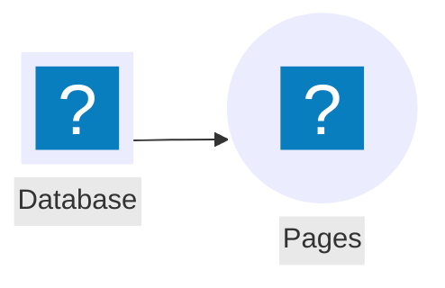

## When the drawing comes out cramped

The ordinary layout crowds big diagrams, above all ones with groups and labelled arrows. For
those there is a second one: write the first line of the example and the same diagram comes
out tidy, with right-angled arrows and no labels on top of each other. There is no need to use
it everywhere: on small diagrams the ordinary layout is just as good and lighter.

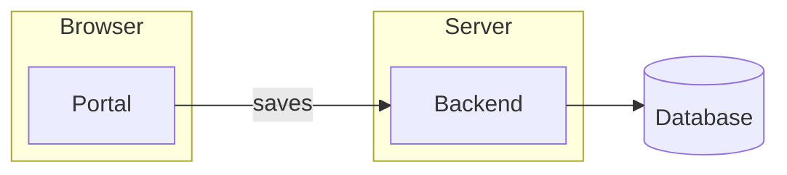

## Colours and theme

Left alone, a diagram is drawn in the colours of the mode the page is being read in, light or
dark, and is redrawn on its own when you switch.

If you want colours of your own, give them with `classDef` and `style`. You can also fix a
whole theme with a directive at the top; that diagram will then look the same by day and by
night, so pick colours that read in both.

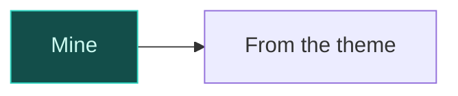

## The kinds you can use

These are all the kinds the page can draw. Each example is written above and drawn below by
the same engine that draws inside your pages, so what you see here is what you will get. Copy
any of them, paste it into a diagram block, and change it into yours.

### Flowchart

Boxes and arrows: steps, decisions and where each path goes. The most used one, and the one to
try first.

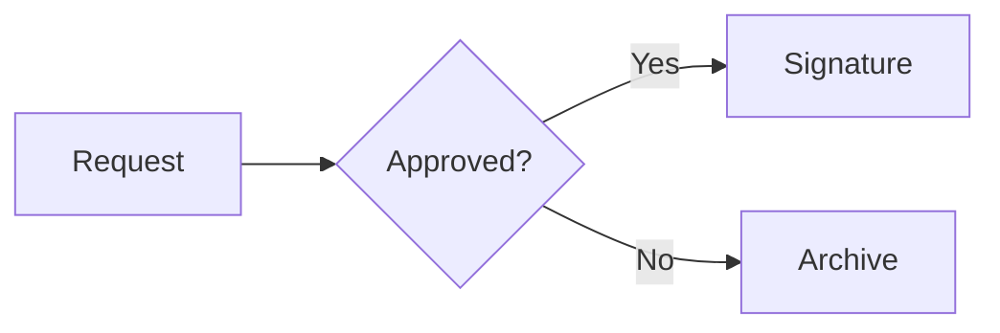

[Full syntax](https://mermaid.js.org/syntax/flowchart.html) for flowchart in the Mermaid documentation.

### Sequence

Who talks to whom and in which order, with time running down the page.

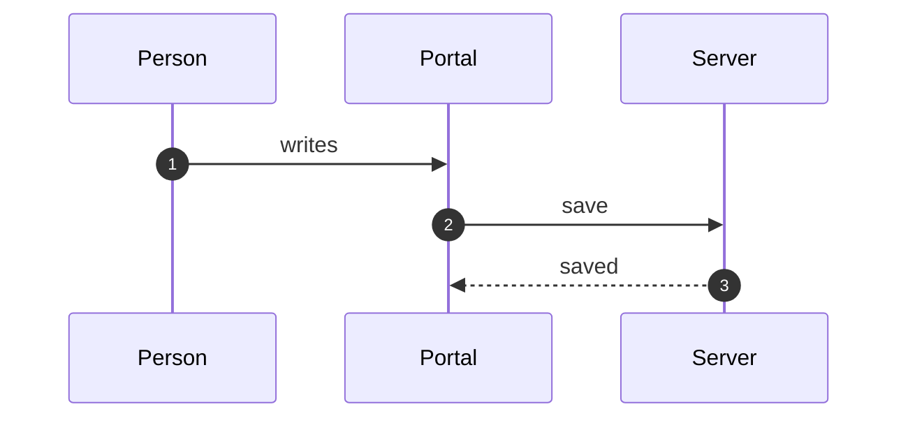

[Full syntax](https://mermaid.js.org/syntax/sequenceDiagram.html) for sequence in the Mermaid documentation.

### Class

What each thing has and can do, and how they relate.

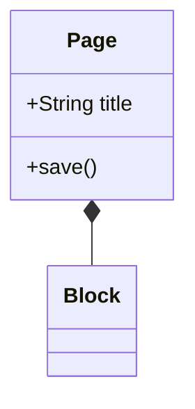

[Full syntax](https://mermaid.js.org/syntax/classDiagram.html) for class in the Mermaid documentation.

### State

What something goes through from birth to end.

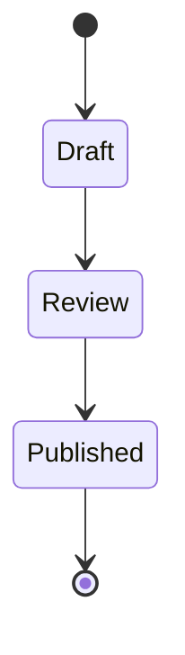

[Full syntax](https://mermaid.js.org/syntax/stateDiagram.html) for state in the Mermaid documentation.

### Entity relationship

What holds what, and how many of each.

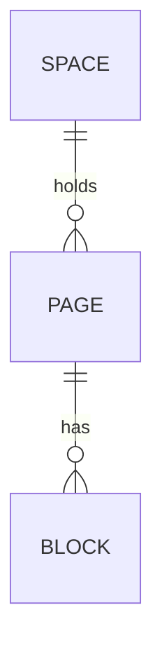

[Full syntax](https://mermaid.js.org/syntax/entityRelationshipDiagram.html) for entity relationship in the Mermaid documentation.

### Gantt chart

How long each task takes and what follows what, on a calendar.

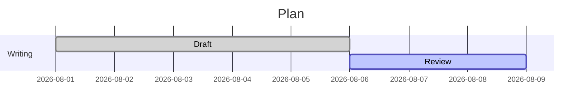

[Full syntax](https://mermaid.js.org/syntax/gantt.html) for gantt chart in the Mermaid documentation.

### Pie

How much of a whole each part takes. Use it with few parts; with many, a treemap reads better.

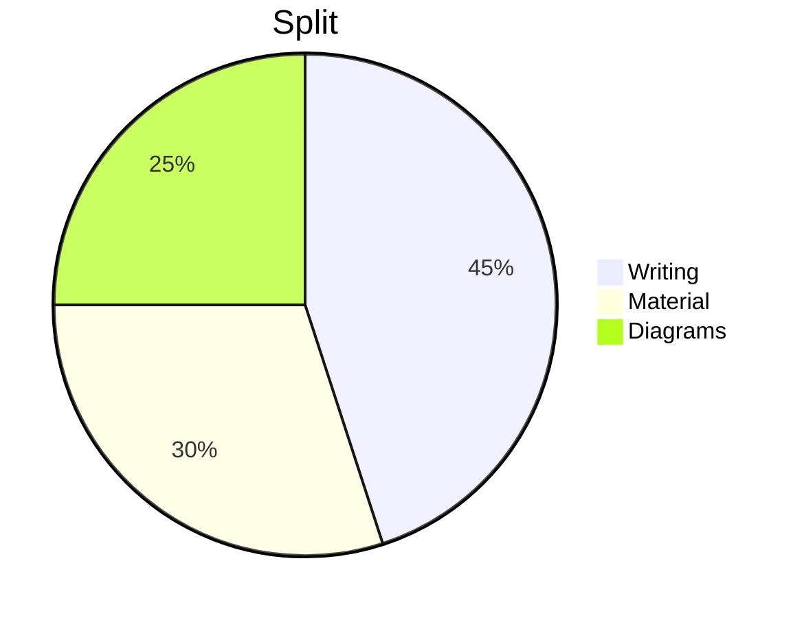

[Full syntax](https://mermaid.js.org/syntax/pie.html) for pie in the Mermaid documentation.

### Mind map

One idea in the middle and everything hanging off it.

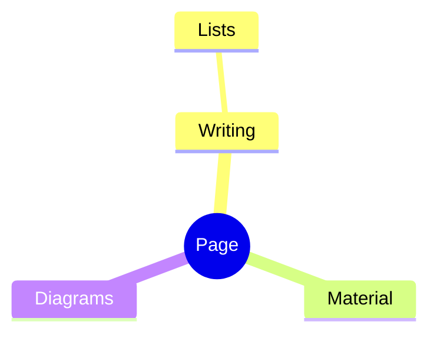

[Full syntax](https://mermaid.js.org/syntax/mindmap.html) for mind map in the Mermaid documentation.

### Timeline

What happened and when, in order.

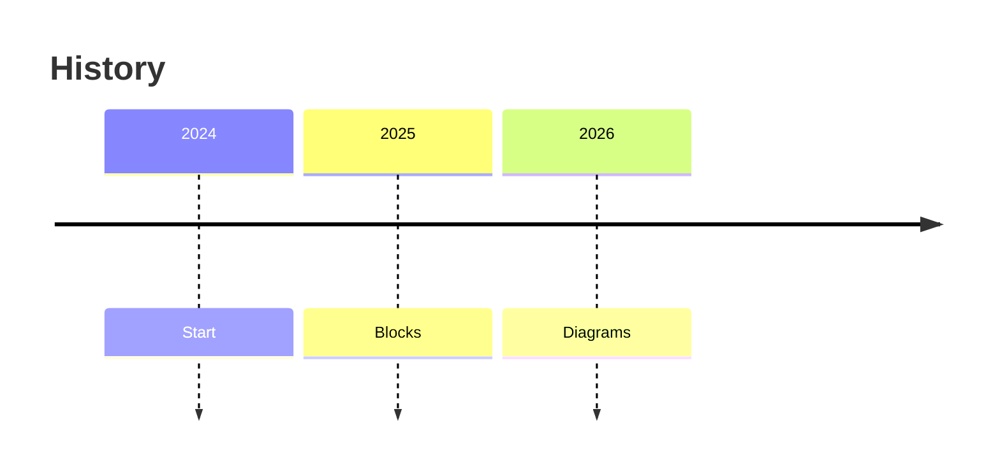

[Full syntax](https://mermaid.js.org/syntax/timeline.html) for timeline in the Mermaid documentation.

### User journey

The steps a person takes and how well each one goes for them.

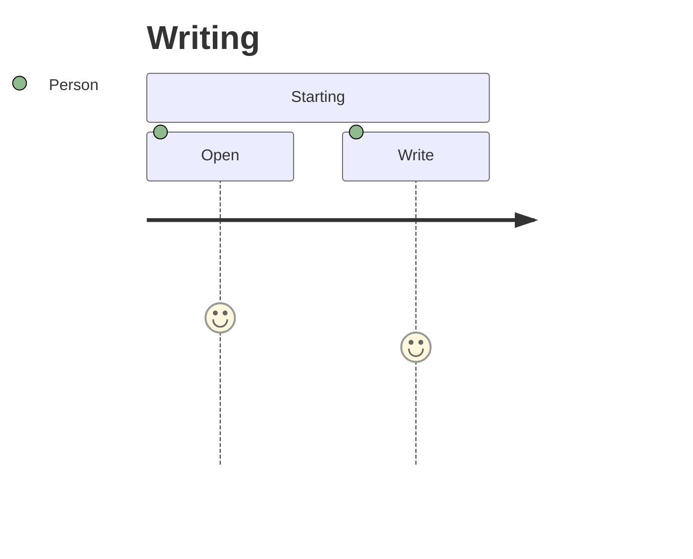

[Full syntax](https://mermaid.js.org/syntax/userJourney.html) for user journey in the Mermaid documentation.

### Quadrant chart

Four boxes to sort decisions by two criteria.

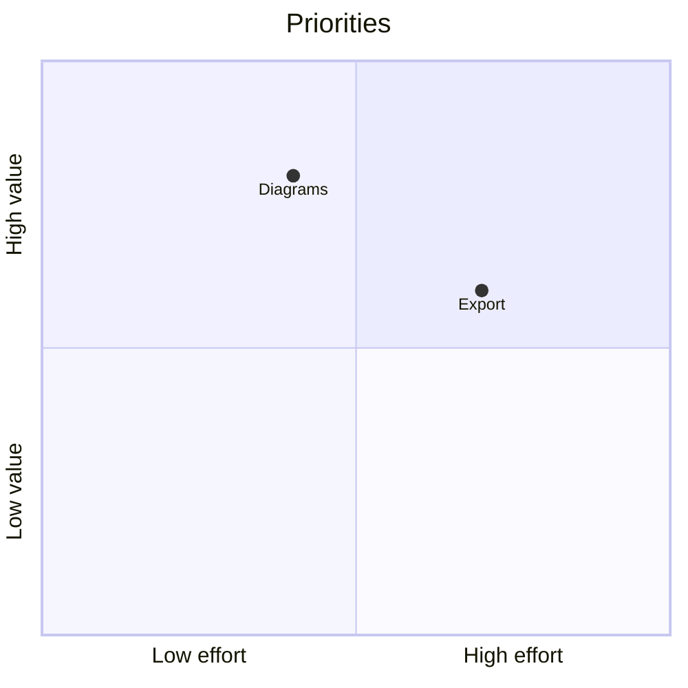

[Full syntax](https://mermaid.js.org/syntax/quadrantChart.html) for quadrant chart in the Mermaid documentation.

### Requirements

What is asked for, at what risk, and how it is verified.

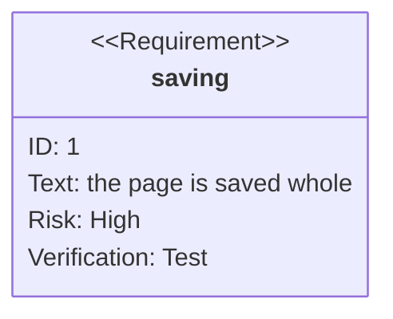

[Full syntax](https://mermaid.js.org/syntax/requirementDiagram.html) for requirements in the Mermaid documentation.

### Git branches

How each branch of the repository was opened and merged.

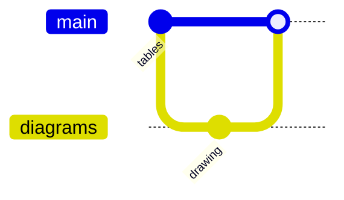

[Full syntax](https://mermaid.js.org/syntax/gitgraph.html) for git branches in the Mermaid documentation.

### Context (C4)

Who uses what, from above: people, your systems and other people's systems.

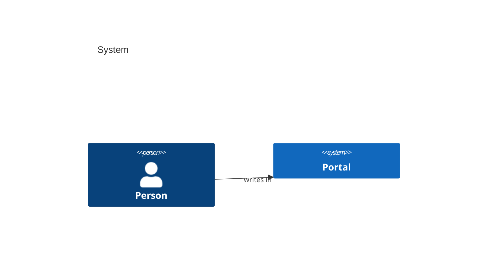

[Full syntax](https://mermaid.js.org/syntax/c4.html) for context (c4) in the Mermaid documentation.

### Flows (Sankey)

Where everything goes and how much of it: budget, traffic, time.

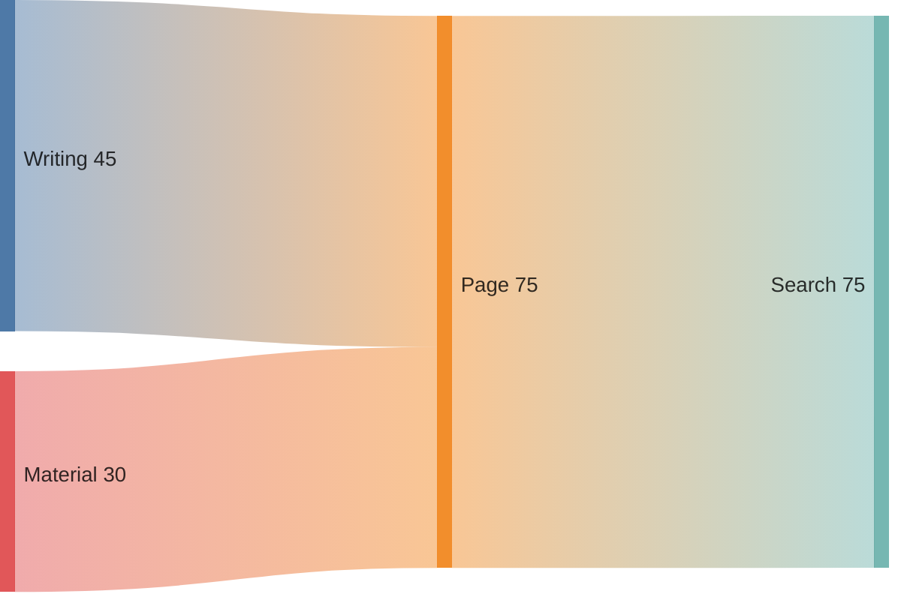

[Full syntax](https://mermaid.js.org/syntax/sankey.html) for flows (sankey) in the Mermaid documentation.

### Bars and lines

Numbers over time or by category.

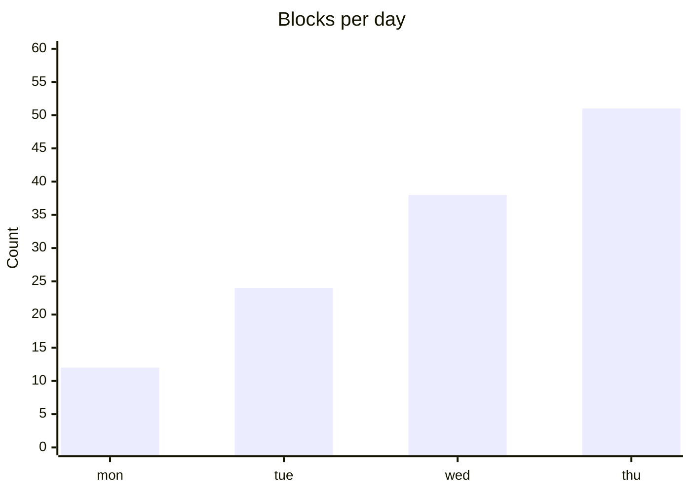

[Full syntax](https://mermaid.js.org/syntax/xyChart.html) for bars and lines in the Mermaid documentation.

### Blocks

Boxes placed on a grid. Good for layers, architectures and anything drawn as a lattice.

```mermaid
block-beta
  columns 3
  Portal["Portal"] space Server["Server"]
```

[Full syntax](https://mermaid.js.org/syntax/block.html) for blocks in the Mermaid documentation.

### Packets

How a message is put together, bit by bit.

```mermaid
packet-beta
  0-15: "Source"
  16-31: "Destination"
  32-63: "Payload"
```

[Full syntax](https://mermaid.js.org/syntax/packet.html) for packets in the Mermaid documentation.

### Kanban

Which column each card is in.

```mermaid
kanban
  To do
    [Export]
  Doing
    [Diagrams]
  Done
    [Tables]
```

[Full syntax](https://mermaid.js.org/syntax/kanban.html) for kanban in the Mermaid documentation.

### Radar

Several measures of the same thing compared at a glance.

```mermaid
radar-beta
  title Editor
  axis writing["Writing"], material["Material"], data["Data"]
  curve today["Today"]{90, 80, 70}
```

[Full syntax](https://mermaid.js.org/syntax/radar.html) for radar in the Mermaid documentation.

### Treemap

Like a pie, but for when there are many parts and the parts have parts of their own.

```mermaid
treemap-beta
"Page"
  "Writing"
    "Paragraphs": 30
    "Lists": 15
  "Diagrams": 10
```

[Full syntax](https://mermaid.js.org/syntax/treemap.html) for treemap in the Mermaid documentation.

### Architecture

Services and groups with a picture each. The one that gains the most from stamps.

```mermaid
architecture-beta
  group cloud(logos:docker-icon)[Server]
  service base(logos:postgresql)[Postgres] in cloud
  service disk(mdi:folder)[Attachments] in cloud
  base:R --> L:disk
```

[Full syntax](https://mermaid.js.org/syntax/architecture.html) for architecture in the Mermaid documentation.

### ZenUML

Another way of telling a sequence, with nested calls as in code. It always draws on white, in
its own colours.

```mermaid
zenuml
  title Saving
  Portal->Server.save() {
    Database.write()
  }
```

[Full syntax](https://mermaid.js.org/syntax/zenuml.html) for zenuml in the Mermaid documentation.

### Venn

What two or more sets have in common.

```mermaid
venn-beta
  title Sets
  set contract["Contract"]
  set editor["Editor"]
```

[Full syntax](https://mermaid.js.org/syntax/venn.html) for venn in the Mermaid documentation.

### Ishikawa (fishbone)

The causes of a problem, sorted by family.

```mermaid
ishikawa-beta
  title Not saving
  branch Contract
    cause Block not declared
  branch Network
    cause No connection
```

[Full syntax](https://mermaid.js.org/syntax/ishikawa.html) for ishikawa (fishbone) in the Mermaid documentation.

### Cynefin

Which ground you are standing on when deciding.

```mermaid
cynefin-beta
  title Decisions
```

[Full syntax](https://mermaid.js.org/syntax/cynefin.html) for cynefin in the Mermaid documentation.

### Wardley

How mature each piece of what you built is, and how much it is worth to whoever uses it.

```mermaid
wardley-beta
  title Editor map
```

[Full syntax](https://mermaid.js.org/syntax/wardley.html) for wardley in the Mermaid documentation.

### Swimlanes

A flow split into lanes, one per area or per person responsible.

```mermaid
swimlane-beta

subgraph writing[Writing]
  a[Draft]
end

subgraph review[Review]
  b[Check]
end

a --> b
```

[Full syntax](https://mermaid.js.org/syntax/swimlanes.html) for swimlanes in the Mermaid documentation.

### Tree

Folders and files, or any hierarchy written with indentation.

```mermaid
treeView-beta
    company/
        contracts/
            2026.pdf
        manual.md
```

[Full syntax](https://mermaid.js.org/syntax/treeView.html) for tree in the Mermaid documentation.

### Event modelling

Screens, commands and events on a timeline.

```mermaid
eventmodeling

tf 01 ui PageUI
tf 02 cmd Save
tf 03 evt Saved
```

[Full syntax](https://mermaid.js.org/syntax/eventmodeling.html) for event modelling in the Mermaid documentation.

### Railroad (grammars)

How a grammar is read, drawn as railway tracks.

```mermaid
railroad-ebnf-beta
greeting = "hello" , name ;
name = letter , { letter } ;
```

[Full syntax](https://mermaid.js.org/syntax/railroad.html) for railroad (grammars) in the Mermaid documentation.

## When something will not draw

- **“The first line does not say what kind of diagram this is”**: check the first word. Case
  matters: it is `flowchart`, not `FlowChart`.
- **“Parse error on line N”**: there is a mistake on that line. The previous drawing stays
  dimmed until you fix it.
- A diagram with more than **five hundred arrows** will not draw: the block says so, and it has
  to be split into several.
- A block longer than **twenty thousand characters** cannot be saved; the page says so and
  stops saving until you shorten it or split it.
- Diagrams are not visible while a toggle is closed: open it and they appear.
