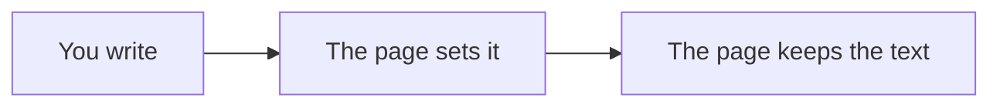

A formula is **written**, just like a diagram: you write it in LaTeX — the language
mathematics has been written in for fifty years — and the page sets it.

What the page keeps is the text, never the image. That is why a formula can be searched,
copied and corrected, and stays the same formula even if it is set differently tomorrow.

The letters it is set in travel with the page, so it looks the same on a machine with no way
out to the internet.

## How to insert one

1. Type `/` on an empty line and choose **Formula**.
2. Write the formula inside the block.
3. You can also start from a code block and switch its language to **Formula** in the block
   bar.

It is set when you stop typing, not on every keystroke. The bar is where you choose what is
shown: only the formula, only the code, or both — which is how an already written one is
corrected.



## What you can write

| What you want | How it is written | What comes out |
|---|---|---|
| Powers and subscripts | `x^2`, `a_1` | raised and lowered |
| Fraction | `\frac{a}{b}` | one over the other |
| Root | `\sqrt{x}`, `\sqrt[3]{x}` | square or any index |
| Sum | `\sum_{i=1}^{n}` | with its limits |
| Integral | `\int_0^\infty` | with its limits |
| Greek letters | `\alpha`, `\beta`, `\pi`, `\Omega` | α, β, π, Ω |
| Matrix | `\begin{pmatrix} a & b \\ c & d \end{pmatrix}` | in brackets |
| Words inside | `\text{if } x > 0` | in ordinary type |

### Examples

```latex
\int_0^\infty e^{-x^2}\,dx = \frac{\sqrt{\pi}}{2}
```

```latex
\sum_{i=1}^{n} i = \frac{n(n+1)}{2}
```

```latex
A = \begin{pmatrix} 1 & 2 \\ 3 & 4 \end{pmatrix}
```

```latex
f(x) = \begin{cases}
  x^2 & \text{if } x \geq 0 \\
  -x^2 & \text{if } x < 0
\end{cases}
```

The full list of what can be written is in the
[KaTeX documentation](https://katex.org/docs/supported), which is what sets the formulas on
these pages.

## When something will not set

- **“Undefined control sequence”**: a command that does not exist; almost always a typo in the
  name or a missing backslash.
- **“Expected 'EOF'”** or braces that do not close: count the `{` and the `}`.
- While the formula is mistyped, the last one that did set stays on screen, dimmed, so you are
  not writing against a blank.
- Commands that would fetch something — an image, a link — are refused: a formula asks nothing
  of anybody else's server.
