Un diagrama se **escribe**: no se arrastra ni se dibuja con el ratón. Escribes unas líneas
describiendo lo que quieres mostrar y la página lo dibuja por ti.

Lo que la página guarda es el texto, nunca la imagen. Por eso un diagrama se puede buscar,
copiar, comparar y corregir años después, y por eso dos personas que escriben lo mismo
obtienen el mismo dibujo.

Los diagramas se escriben en **Mermaid**, que es el lenguaje de diagramas más extendido: el
mismo que entienden GitHub, GitLab y Notion. Lo que escribas aquí sirve tal cual en cualquiera
de ellos, y al revés. Cada tipo tiene su propia página de sintaxis, enlazada más abajo, y todas
cuelgan de la [documentación de Mermaid](https://mermaid.js.org/intro/syntax-reference.html).

## Cómo insertar uno

1. Escribe `/` en una línea vacía y elige **Diagrama**.
2. Escribe el diagrama dentro del bloque. La primera línea dice de qué tipo es: `flowchart`,
   `sequenceDiagram`, `gantt`, y así.
3. También puedes partir de un bloque de código y cambiar el idioma a **Diagrama** en la barra
   del bloque: lo que ya estaba escrito se intenta dibujar tal cual.

El dibujo se rehace cuando dejas de escribir, no en cada tecla. Mientras escribes, el dibujo
anterior se queda en pantalla algo apagado hasta que lo nuevo se pueda dibujar.

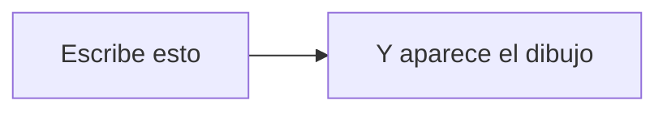

## Ver el código, el dibujo o los dos

En la barra del bloque eliges qué se muestra: **solo el dibujo**, **solo el código**, o **los
dos**. Lo que elijas se guarda con la página, así que quien la lea después verá lo mismo que
dejaste.

- **Copiar** copia el texto del diagrama, listo para pegarlo en otra página.
- **Descargar** guarda el dibujo como archivo SVG: es un dibujo de verdad, no una foto, así
  que se puede ampliar sin que se pixele.
- **Pantalla completa** lo lleva a toda la pantalla.

## Leer uno grande

Un diagrama se muestra al tamaño en que fue dibujado. Si resulta más ancho que la columna, no
se encoge: es su propia caja la que se desplaza, así que el texto de dentro se sigue leyendo.

- Arrastra el dibujo con el ratón para recorrerlo cuando no cabe entero.
- Con `Ctrl` (o `⌘`) y la rueda del ratón lo acercas y lo alejas.
- Al imprimir la página, un diagrama demasiado ancho se ajusta a la hoja en vez de quedar
  cortado, y los botones del bloque no se imprimen.

## Estampas y logos

Algunos tipos de diagrama admiten dibujos dentro de las cajas. Se nombran con dos partes
separadas por dos puntos: el libro y el nombre del dibujo.

Hay dos libros disponibles:

| Libro | Qué trae | Cuándo usarlo |
|---|---|---|
| `logos` | Las marcas de productos conocidos, con sus colores propios | Para nombrar tecnologías y servicios |
| `mdi` | Dibujos de uso general de un solo color, que siguen el tema de la página | Para todo lo demás, y siempre que deba verse bien en claro y en oscuro |

Los dibujos los sirve este mismo espacio de trabajo: nombrar una estampa nunca hace que tu
navegador le pida nada a un servidor ajeno, y todo sigue funcionando sin salida a internet. Si
nombras una que no existe, verás un cuadrado con un signo de interrogación en su lugar y el
resto del diagrama se dibuja igual.

```icons
logos:postgresql
logos:nestjs
logos:nextjs-icon
logos:docker-icon
logos:typescript-icon
logos:react
logos:google-cloud
logos:aws
mdi:account
mdi:folder
mdi:file-document
mdi:database
mdi:server
mdi:email
mdi:cog
mdi:alert-circle
```

Cualquier nombre de estos dos catálogos funciona, no solo los de arriba. Búscalo en
[Logos](https://icon-sets.iconify.design/logos/) o en
[Material Design Icons](https://icon-sets.iconify.design/mdi/) y escribe el nombre tal como
aparece ahí, con el libro delante.

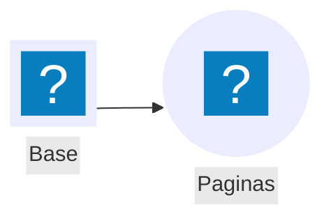

## Cuando el dibujo queda apretado

El reparto normal amontona los diagramas grandes, sobre todo si tienen grupos y etiquetas en
las flechas. Para esos casos hay un segundo repartidor: escribe la primera línea del ejemplo y
el mismo diagrama queda ordenado, con las flechas en ángulo recto y sin etiquetas encimadas.
No hace falta usarlo siempre: en diagramas pequeños el reparto normal es igual de bueno y más
liviano.

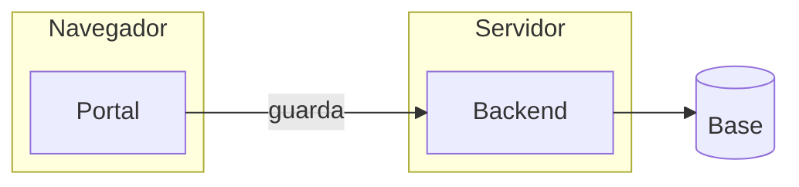

## Colores y tema

Sin decir nada, un diagrama se dibuja con los colores del modo en que se está leyendo la
página, claro u oscuro, y se vuelve a dibujar solo cuando cambias de modo.

Si quieres colores propios, dáselos con `classDef` y `style`. También puedes fijar un tema
completo con una directiva al principio; en ese caso el diagrama se verá igual de día y de
noche, así que elige colores que se lean en ambos.

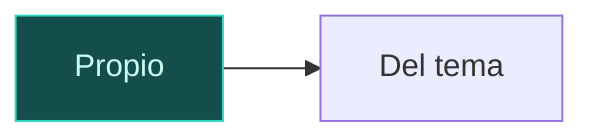

## Los tipos que puedes usar

Estos son todos los tipos que la página sabe dibujar. Cada ejemplo está escrito arriba y
dibujado abajo por la misma máquina que dibuja dentro de tus páginas, así que lo que ves aquí
es exactamente lo que obtendrás. Copia cualquiera, pégalo en un bloque de diagrama y cámbialo
por lo tuyo.

### Flujo

Cajas y flechas: pasos, decisiones y por dónde sigue cada camino. Es el más usado y el que
conviene probar primero.

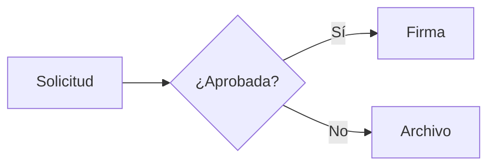

[Sintaxis completa](https://mermaid.js.org/syntax/flowchart.html) de flujo en la documentación de Mermaid.

### Secuencia

Quién le habla a quién y en qué orden, con el tiempo bajando por la página.

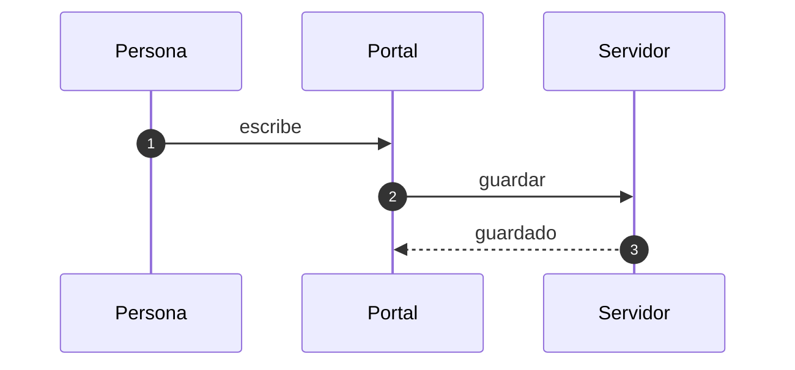

[Sintaxis completa](https://mermaid.js.org/syntax/sequenceDiagram.html) de secuencia en la documentación de Mermaid.

### Clases

Qué tiene cada cosa y qué sabe hacer, y cómo se relacionan entre sí.

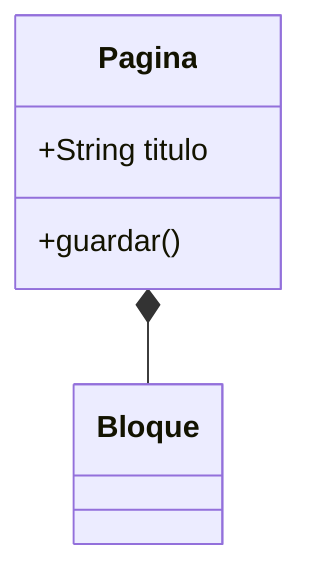

[Sintaxis completa](https://mermaid.js.org/syntax/classDiagram.html) de clases en la documentación de Mermaid.

### Estados

Por dónde pasa algo desde que nace hasta que termina.

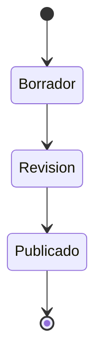

[Sintaxis completa](https://mermaid.js.org/syntax/stateDiagram.html) de estados en la documentación de Mermaid.

### Entidad-relación

Qué guarda qué, y cuántos de cada uno.

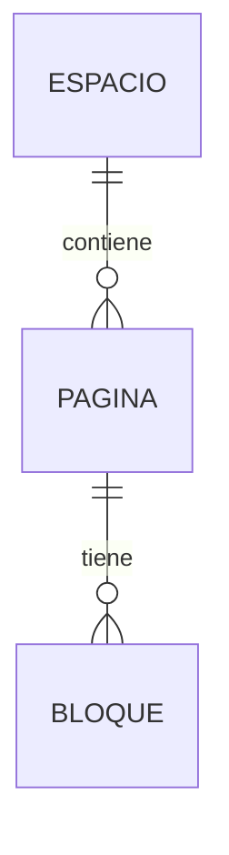

[Sintaxis completa](https://mermaid.js.org/syntax/entityRelationshipDiagram.html) de entidad-relación en la documentación de Mermaid.

### Carta Gantt

Cuánto dura cada tarea y qué va después de qué, en un calendario.

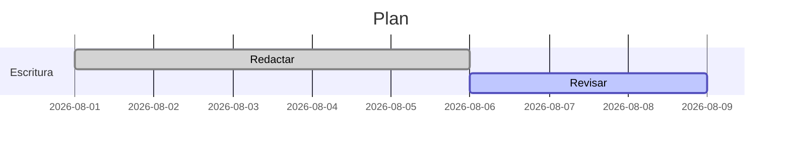

[Sintaxis completa](https://mermaid.js.org/syntax/gantt.html) de carta gantt en la documentación de Mermaid.

### Pastel

Cuánto pesa cada parte de un todo. Úsalo con pocas partes; con muchas, mejor un treemap.

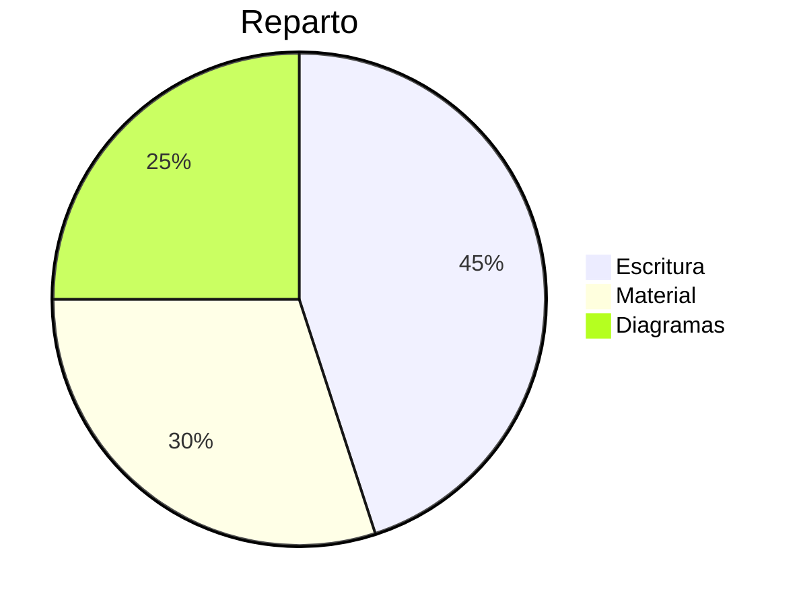

[Sintaxis completa](https://mermaid.js.org/syntax/pie.html) de pastel en la documentación de Mermaid.

### Mapa mental

Una idea al centro y todo lo que cuelga de ella.

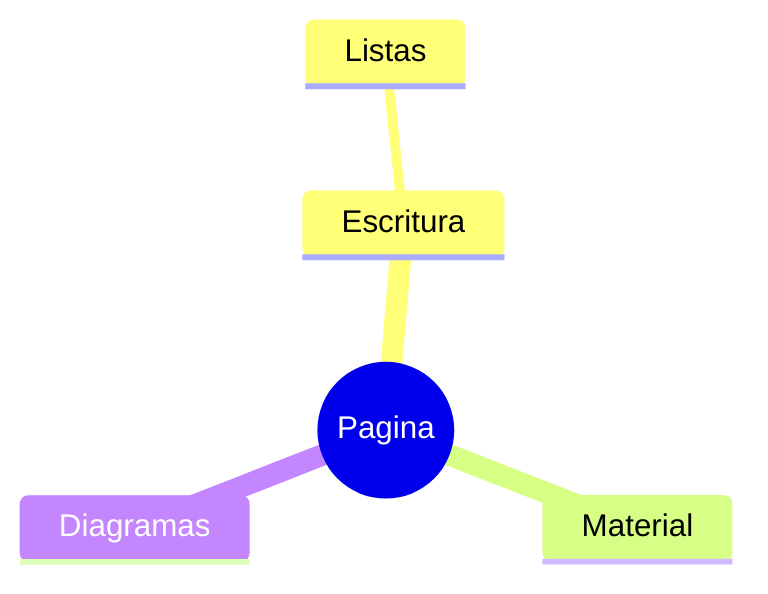

[Sintaxis completa](https://mermaid.js.org/syntax/mindmap.html) de mapa mental en la documentación de Mermaid.

### Línea de tiempo

Qué pasó y cuándo, en orden.

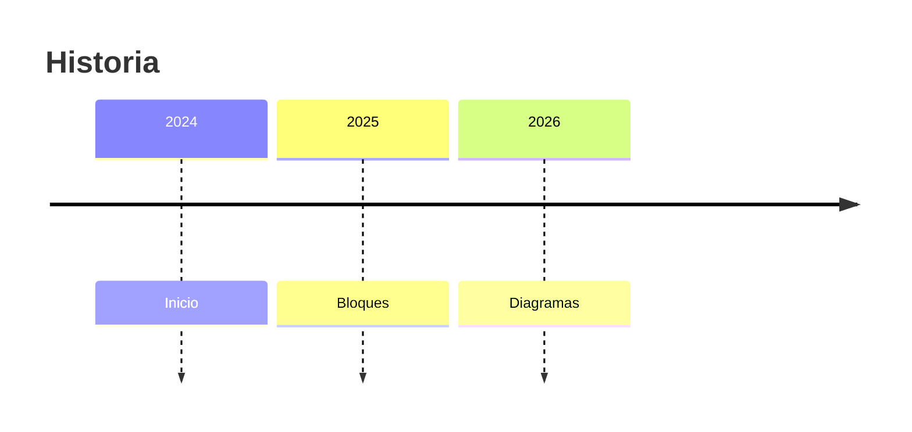

[Sintaxis completa](https://mermaid.js.org/syntax/timeline.html) de línea de tiempo en la documentación de Mermaid.

### Recorrido de usuario

Los pasos que da una persona y qué tan bien lo pasa en cada uno.

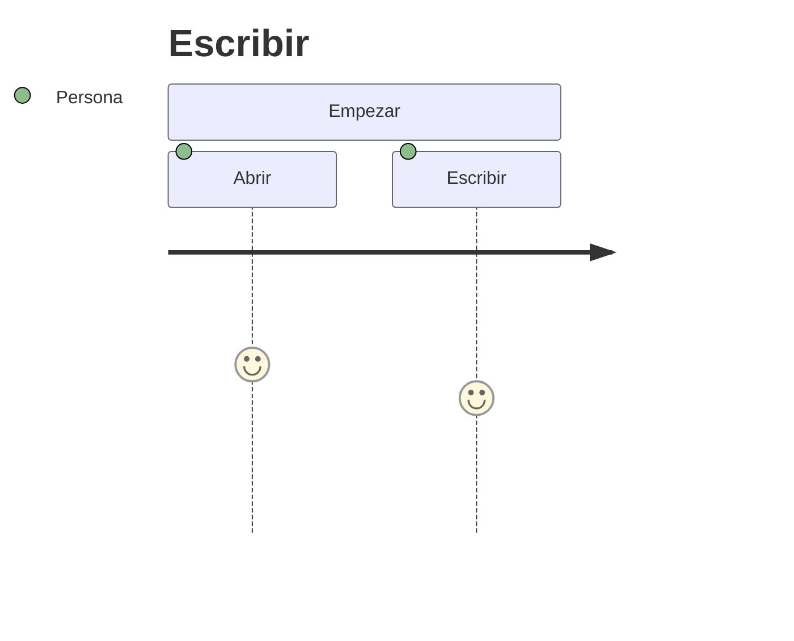

[Sintaxis completa](https://mermaid.js.org/syntax/userJourney.html) de recorrido de usuario en la documentación de Mermaid.

### Cuadrantes

Cuatro casillas para ordenar decisiones según dos criterios.

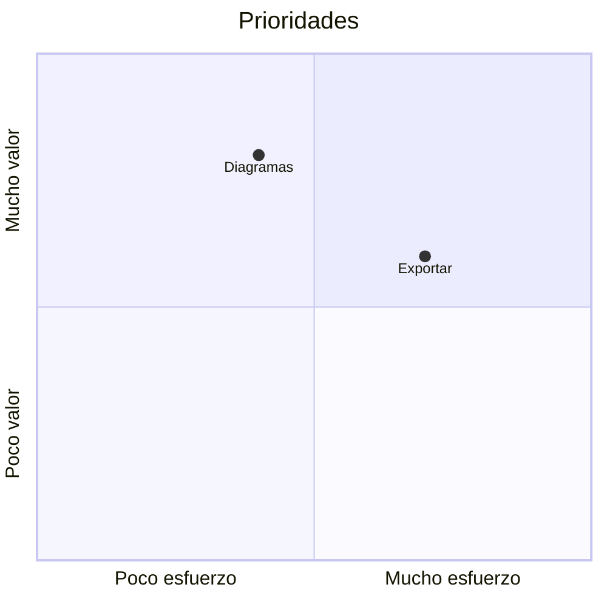

[Sintaxis completa](https://mermaid.js.org/syntax/quadrantChart.html) de cuadrantes en la documentación de Mermaid.

### Requisitos

Lo que se pide, con qué riesgo y cómo se comprueba que se cumplió.

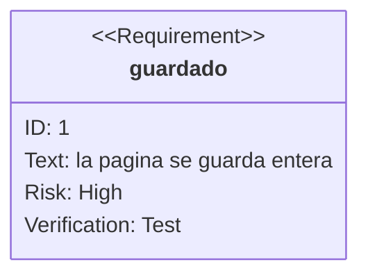

[Sintaxis completa](https://mermaid.js.org/syntax/requirementDiagram.html) de requisitos en la documentación de Mermaid.

### Ramas de git

Cómo se abrió y se juntó cada rama del repositorio.

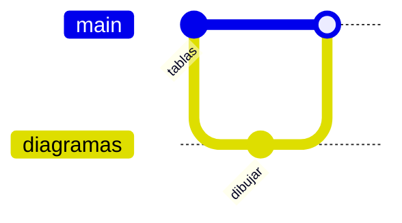

[Sintaxis completa](https://mermaid.js.org/syntax/gitgraph.html) de ramas de git en la documentación de Mermaid.

### Contexto (C4)

Quién usa qué, a vista de pájaro: personas, sistemas propios y sistemas ajenos.

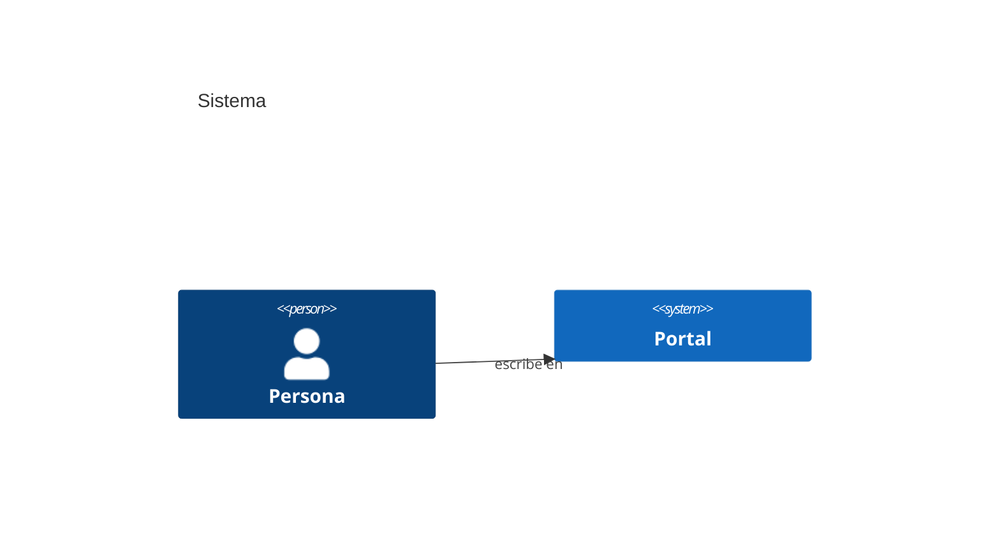

[Sintaxis completa](https://mermaid.js.org/syntax/c4.html) de contexto (c4) en la documentación de Mermaid.

### Flujos (Sankey)

Por dónde se va cada cosa y cuánto: presupuesto, tráfico, tiempo.

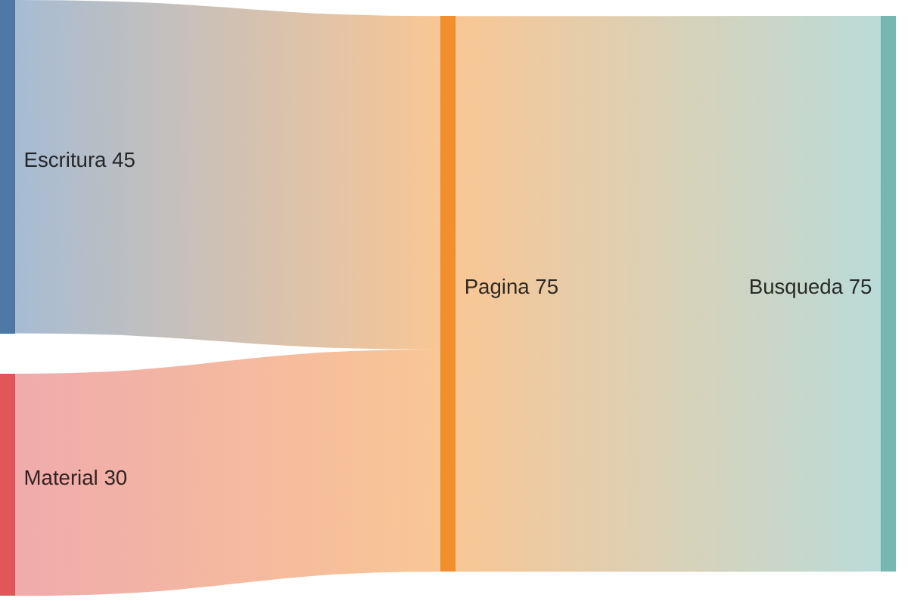

[Sintaxis completa](https://mermaid.js.org/syntax/sankey.html) de flujos (sankey) en la documentación de Mermaid.

### Barras y líneas

Números en el tiempo o por categoría.

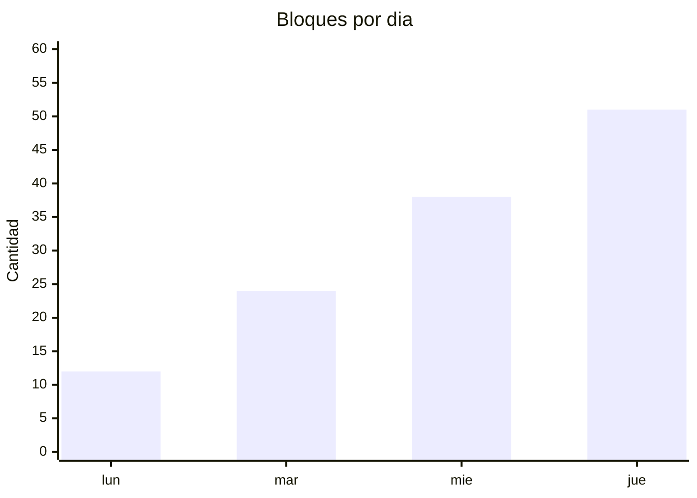

[Sintaxis completa](https://mermaid.js.org/syntax/xyChart.html) de barras y líneas en la documentación de Mermaid.

### Bloques

Cajas puestas en una reja. Sirve para capas, arquitecturas y cualquier cosa en cuadrícula.

```mermaid
block-beta
  columns 3
  Portal["Portal"] space Servidor["Servidor"]
```

[Sintaxis completa](https://mermaid.js.org/syntax/block.html) de bloques en la documentación de Mermaid.

### Paquetes

Cómo viene armado un mensaje, bit por bit.

```mermaid
packet-beta
  0-15: "Origen"
  16-31: "Destino"
  32-63: "Contenido"
```

[Sintaxis completa](https://mermaid.js.org/syntax/packet.html) de paquetes en la documentación de Mermaid.

### Kanban

En qué columna está cada tarjeta.

```mermaid
kanban
  Pendiente
    [Exportar]
  Haciendo
    [Diagramas]
  Listo
    [Tablas]
```

[Sintaxis completa](https://mermaid.js.org/syntax/kanban.html) de kanban en la documentación de Mermaid.

### Radar

Varias medidas de lo mismo comparadas de una mirada.

```mermaid
radar-beta
  title Editor
  axis escritura["Escritura"], material["Material"], datos["Datos"]
  curve hoy["Hoy"]{90, 80, 70}
```

[Sintaxis completa](https://mermaid.js.org/syntax/radar.html) de radar en la documentación de Mermaid.

### Treemap

Lo mismo que un pastel, pero cuando hay muchas partes y además tienen partes dentro.

```mermaid
treemap-beta
"Pagina"
  "Escritura"
    "Parrafos": 30
    "Listas": 15
  "Diagramas": 10
```

[Sintaxis completa](https://mermaid.js.org/syntax/treemap.html) de treemap en la documentación de Mermaid.

### Arquitectura

Servicios y grupos con su dibujo propio. Es el que mejor se ve con estampas.

```mermaid
architecture-beta
  group nube(logos:docker-icon)[Servidor]
  service base(logos:postgresql)[Postgres] in nube
  service disco(mdi:folder)[Adjuntos] in nube
  base:R --> L:disco
```

[Sintaxis completa](https://mermaid.js.org/syntax/architecture.html) de arquitectura en la documentación de Mermaid.

### ZenUML

Otra forma de contar una secuencia, con llamadas anidadas como en el código. Se dibuja siempre
sobre fondo blanco, con sus propios colores.

```mermaid
zenuml
  title Guardar
  Portal->Servidor.guardar() {
    Base.escribir()
  }
```

[Sintaxis completa](https://mermaid.js.org/syntax/zenuml.html) de zenuml en la documentación de Mermaid.

### Venn

Qué comparten dos o más conjuntos.

```mermaid
venn-beta
  title Conjuntos
  set contrato["Contrato"]
  set editor["Editor"]
```

[Sintaxis completa](https://mermaid.js.org/syntax/venn.html) de venn en la documentación de Mermaid.

### Ishikawa (espina de pescado)

Las causas de un problema, ordenadas por familia.

```mermaid
ishikawa-beta
  title No se guarda
  branch Contrato
    cause Bloque no declarado
  branch Red
    cause Sin conexion
```

[Sintaxis completa](https://mermaid.js.org/syntax/ishikawa.html) de ishikawa (espina de pescado) en la documentación de Mermaid.

### Cynefin

En qué terreno estás parado al decidir.

```mermaid
cynefin-beta
  title Decisiones
```

[Sintaxis completa](https://mermaid.js.org/syntax/cynefin.html) de cynefin en la documentación de Mermaid.

### Wardley

Qué tan maduro es cada pedazo de lo que armaste y cuánto valor tiene para quien lo usa.

```mermaid
wardley-beta
  title Mapa del editor
```

[Sintaxis completa](https://mermaid.js.org/syntax/wardley.html) de wardley en la documentación de Mermaid.

### Carriles

Un flujo repartido en carriles, uno por área o por responsable.

```mermaid
swimlane-beta

subgraph escritura[Escritura]
  a[Redactar]
end

subgraph revision[Revision]
  b[Revisar]
end

a --> b
```

[Sintaxis completa](https://mermaid.js.org/syntax/swimlanes.html) de carriles en la documentación de Mermaid.

### Árbol

Carpetas y archivos, o cualquier jerarquía escrita con sangrías.

```mermaid
treeView-beta
    empresa/
        contratos/
            2026.pdf
        manual.md
```

[Sintaxis completa](https://mermaid.js.org/syntax/treeView.html) de árbol en la documentación de Mermaid.

### Modelado por eventos

Pantallas, órdenes y hechos en una línea de tiempo.

```mermaid
eventmodeling

tf 01 ui PaginaUI
tf 02 cmd Guardar
tf 03 evt Guardada
```

[Sintaxis completa](https://mermaid.js.org/syntax/eventmodeling.html) de modelado por eventos en la documentación de Mermaid.

### Vías (gramáticas)

Cómo se lee una gramática, dibujada como vías de tren.

```mermaid
railroad-ebnf-beta
saludo = "hola" , nombre ;
nombre = letra , { letra } ;
```

[Sintaxis completa](https://mermaid.js.org/syntax/railroad.html) de vías (gramáticas) en la documentación de Mermaid.

## Cuando algo no se dibuja

- **«La primera línea no dice qué tipo de diagrama es»**: revisa la primera palabra. Distingue
  mayúsculas de minúsculas: se escribe `flowchart`, no `FlowChart`.
- **«Parse error on line N»**: hay un error de escritura en esa línea. El dibujo anterior se
  queda apagado hasta que lo arregles.
- Un diagrama con más de **quinientas flechas** no se dibuja: el bloque avisa y hay que
  partirlo en varios.
- Un bloque con más de **veinte mil caracteres** no se puede guardar; la página avisa y deja de
  guardarse hasta que lo acortes o lo repartas.
- Los diagramas no se ven mientras un plegable está cerrado: ábrelo y aparecen.
