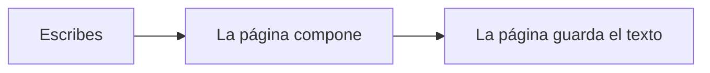

Una fórmula se **escribe**, igual que un diagrama: escribes la fórmula en LaTeX —el lenguaje
en que se escriben las matemáticas desde hace cincuenta años— y la página la compone.

Lo que la página guarda es el texto, nunca la imagen. Por eso una fórmula se puede buscar,
copiar y corregir, y sigue siendo la misma fórmula aunque mañana se componga de otra manera.

Las letras con que se compone viajan con la página, así que se ve igual en una máquina sin
salida a internet.

## Cómo insertar una

1. Escribe `/` en una línea vacía y elige **Fórmula**.
2. Escribe la fórmula dentro del bloque.
3. También puedes partir de un bloque de código y cambiar el idioma a **Fórmula** en la barra
   del bloque.

Se compone cuando dejas de escribir, no en cada tecla. En la barra eliges qué se muestra: solo
la fórmula, solo el código, o los dos —que es como se corrige una ya escrita—.



## Lo que puedes escribir

| Qué quieres | Cómo se escribe | Cómo queda |
|---|---|---|
| Elevado y subíndice | `x^2`, `a_1` | potencia y subíndice |
| Fracción | `\frac{a}{b}` | una sobre otra |
| Raíz | `\sqrt{x}`, `\sqrt[3]{x}` | cuadrada o de cualquier índice |
| Sumatoria | `\sum_{i=1}^{n}` | con sus límites |
| Integral | `\int_0^\infty` | con sus límites |
| Letras griegas | `\alpha`, `\beta`, `\pi`, `\Omega` | α, β, π, Ω |
| Matriz | `\begin{pmatrix} a & b \\ c & d \end{pmatrix}` | entre paréntesis |
| Texto dentro | `\text{si } x > 0` | en letra normal |

### Ejemplos

```latex
\int_0^\infty e^{-x^2}\,dx = \frac{\sqrt{\pi}}{2}
```

```latex
\sum_{i=1}^{n} i = \frac{n(n+1)}{2}
```

```latex
A = \begin{pmatrix} 1 & 2 \\ 3 & 4 \end{pmatrix}
```

```latex
f(x) = \begin{cases}
  x^2 & \text{si } x \geq 0 \\
  -x^2 & \text{si } x < 0
\end{cases}
```

La lista completa de lo que se puede escribir está en la
[documentación de KaTeX](https://katex.org/docs/supported), que es lo que compone las fórmulas
de estas páginas.

## Cuando algo no se compone

- **«Undefined control sequence»**: hay un comando que no existe; casi siempre es una errata
  en el nombre o una barra invertida de menos.
- **«Expected 'EOF'»** o llaves que no cierran: cuenta las `{` y las `}`.
- Mientras la fórmula está mal escrita, la última que sí se compuso se queda en pantalla
  apagada, para no dejarte escribiendo contra un hueco.
- Los comandos que traerían algo de fuera —una imagen, un enlace— no se permiten: una fórmula
  no le pide nada a ningún servidor ajeno.
